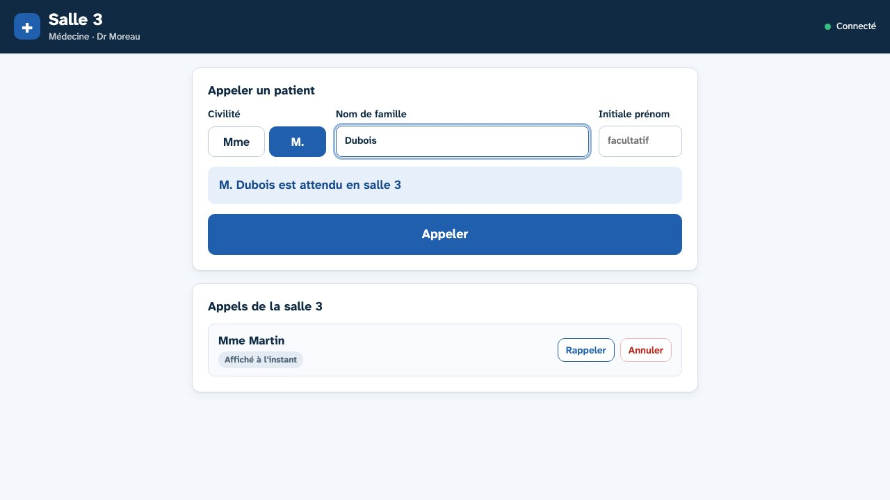
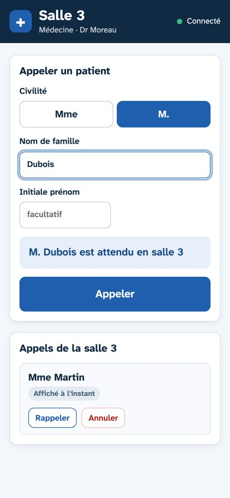

# Patiento

**Système d'appel des patients pour salle d'attente**, destiné aux cabinets médicaux, paramédicaux et aux maisons de santé.

Le praticien appelle son patient depuis son PC ou son smartphone. La TV de la salle d'attente affiche « Mme Martin est attendue en salle 3 », joue un carillon et fait une annonce vocale. Entre deux appels, elle montre un diaporama, les messages de la structure et la liste des salles avec leur praticien.


| Écran au repos | Page du praticien |
| --- | --- |
|  |  |

*Captures réalisées avec des données fictives.*

## Points forts

- **Simple à installer** : un Raspberry Pi branché derrière la TV, un script d'installation, et c'est prêt.
- **Sans abonnement ni cloud** : tout fonctionne sur le réseau local, même sans accès à Internet.
- **Respectueux de la confidentialité** : les noms des patients restent en mémoire vive et ne sont jamais écrits sur le disque.
- **Lisible de loin** : police conçue pour la lisibilité (Atkinson Hyperlegible Next), contrastes élevés, nom du patient affiché en très grand.
- **Adaptable** : nombre de salles, pôles, praticiens, horaires et messages se règlent depuis une page web, sans toucher au code.
- **Léger et maintenable** : un seul programme Python sans dépendance, des pages HTML/CSS/JavaScript sans framework, pas de base de données.

## Sommaire

- [Fonctionnement](#fonctionnement)
- [Les pages](#les-pages)
- [Matériel nécessaire](#matériel-nécessaire)
- [Essayer sur un PC](#essayer-sur-un-pc)
- [Installer sur le Raspberry Pi](#installer-sur-le-raspberry-pi)
- [Première configuration](#première-configuration)
- [Adapter Patiento à votre structure](#adapter-patiento-à-votre-structure)
- [Utilisation au quotidien](#utilisation-au-quotidien)
- [Confidentialité et sécurité](#confidentialité-et-sécurité)
- [Maintenance](#maintenance)
- [Réglages avancés](#réglages-avancés)
- [Dépannage](#dépannage)
- [Contenu du dépôt](#contenu-du-dépôt)
- [Licence et crédits](#licence-et-crédits)

## Fonctionnement

```
 PC / smartphone du praticien              Raspberry Pi                    TV (HDMI)
┌──────────────────────────┐        ┌──────────────────────┐        ┌───────────────────┐
│ http://IP-DU-PI/appel    │ appel  │  server.py           │ temps  │ Chromium (kiosque)│
│ ?salle=3                 ├───────▶│  - appels en mémoire │ réel   │ /ecran            │
│ « Mme Martin »  [Appeler]│  HTTP  │  - config.json       ├───────▶│ carillon + voix   │
└──────────────────────────┘        │  - voix (option)     │  SSE   │ diaporama,        │
                                    └──────────────────────┘        │ messages, salles  │
                                                                    └───────────────────┘
```

1. Le praticien ouvre la page d'appel de **sa salle**, choisit M. ou Mme, saisit le nom de famille (et, en cas d'homonymes, l'initiale du prénom), puis clique sur **Appeler**.
2. Le serveur enregistre l'appel **en mémoire vive uniquement** et prévient immédiatement l'écran par un flux d'événements (`/evenements`, Server-Sent Events). L'affichage est instantané, sans actualisation périodique.
3. La TV affiche la phrase en plein écran pendant la durée réglée (25 s par défaut), joue le carillon et lit l'annonce à voix haute. Si plusieurs praticiens appellent en même temps, les appels passent l'un après l'autre.
4. L'appel reste ensuite dans l'encart « Derniers appels » (5 minutes par défaut), puis disparaît. Le praticien peut **rappeler** (l'annonce est rejouée) ou **annuler** un appel.
5. Sans appel en cours, la TV affiche le diaporama, les messages qui défilent, la liste des salles et des praticiens (regroupés par pôle) et l'horloge. En dehors des horaires réglés, l'écran passe au noir.

Les salles, les praticiens, les messages, le diaporama et les réglages sont enregistrés dans `config.json`. Aucun nom de patient n'y figure jamais.

### Annonce vocale

Deux modes, au choix à l'installation :

- **Voix du navigateur** (par défaut) : la TV utilise la synthèse vocale intégrée à Chromium.
- **Voix Piper** (`--avec-voix`) : synthèse vocale française hors ligne, plus naturelle. La voix est générée en mémoire, sans fichier sur le disque, et envoyée à l'écran via `/api/voix/<id>`.

L'annonce reprend la phrase affichée, avec « Madame » ou « Monsieur » en toutes lettres.

### Diaporama

Les présentations PowerPoint (`.pptx`, `.ppt`, `.ppsx`, `.pps`), OpenDocument (`.odp`) et les PDF se déposent depuis la page **Contenus** (200 Mo au maximum). Le serveur les convertit en images avec LibreOffice et `pdftoppm`, puis la TV les fait défiler. Les images `.png` et `.jpg` sont aussi acceptées. Un seul diaporama est actif à la fois. Les animations et transitions ne sont pas reprises.

Conseils pour des diapositives lisibles depuis le fond de la salle :

- format **16:9**, **gros caractères**, peu de texte ;
- rien d'important dans le **coin inférieur droit** : l'encart « Derniers appels » s'y superpose pendant quelques minutes après chaque appel.

## Les pages

| Adresse | Pour qui | Rôle |
| --- | --- | --- |
| `/` | Tous | Accueil avec les liens vers les autres pages |
| `/appel?salle=3` | Praticien | Appeler, rappeler ou annuler un appel pour sa salle (PC ou smartphone) |
| `/contenus` | Secrétariat, gestionnaire | Diaporama, messages, salles et praticiens, liens d'appel, réglages |
| `/ecran` | TV | Affichage de la salle d'attente |



## Matériel nécessaire

| Élément | Recommandation |
| --- | --- |
| Ordinateur | Raspberry Pi 4 ou 5, 4 Go de mémoire conseillés (la conversion des PowerPoint est gourmande), carte microSD de 32 Go |
| Système | Raspberry Pi OS **avec bureau**, version Bookworm ou plus récente |
| Écran | TV Full HD avec entrée HDMI, de préférence avec HDMI-CEC et une mise en veille automatique désactivable |
| Son | haut-parleurs de la TV (le son passe par le HDMI) |
| Réseau | prise Ethernet près de la TV et **adresse IP fixe** pour le Pi (réservation DHCP) |
| Postes des praticiens | n'importe quel navigateur récent, sur le même réseau local |

Le Pi a besoin d'Internet **uniquement pendant l'installation** (paquets système et, en option, voix Piper).

## Essayer sur un PC

Il faut Python 3.9 ou plus récent, sans aucune bibliothèque à installer.

```bash
python3 server.py
```

Puis :

1. ouvrir `http://localhost:8080/contenus` pour renseigner les salles ;
2. ouvrir `http://localhost:8080/ecran` dans une autre fenêtre (touche F11 pour le plein écran) ;
3. cliquer une fois sur la page écran pour autoriser le son ;
4. faire les appels depuis `http://localhost:8080/appel`.

Sans fichier `data/config.json`, le serveur démarre avec une configuration type de maison de santé : 12 salles réparties en 4 pôles, sans nom de praticien. Pour partir d'un exemple rempli avec des noms fictifs :

```bash
cp data/config.example.json data/config.json
```

Si le port 8080 est déjà pris : `APPEL_PORT=8081 python3 server.py`.

La conversion des présentations nécessite LibreOffice (`soffice`) et `pdftoppm` (paquet `poppler-utils`, ou `brew install poppler` sur Mac). Sans eux, tout fonctionne sauf le dépôt de présentations.

## Installer sur le Raspberry Pi

### Installation

1. Copier ce dossier sur le Pi, ou le cloner :

   ```bash
   git clone https://github.com/r3yyz/patiento-app.git
   ```

2. Depuis le compte qui ouvre la session du bureau (par exemple `pi`), lancer le script avec `sudo` :

   ```bash
   cd patiento-app
   sudo ./installer/install.sh              # ou : sudo ./installer/install.sh --avec-voix
   sudo reboot
   ```

Au redémarrage, la TV affiche directement l'écran de la salle d'attente. L'application écoute sur le port 80 : les praticiens utilisent `http://IP-DU-PI/appel?salle=N`. Le script affiche ces adresses à la fin de l'installation.

### Ce que fait le script

| Étape | Détail |
| --- | --- |
| Paquets | Python 3, LibreOffice Impress, poppler-utils, polices de substitution pour les PowerPoint, Chromium |
| Application | copiée dans `/opt/patiento`, données dans `/var/lib/patiento` |
| Service | utilisateur système dédié `appel`, service systemd `patiento` démarré au boot et relancé en cas de plantage, avec des protections systemd (système en lecture seule, pas d'accès aux dossiers personnels) |
| Voix (option) | environnement Python dédié, Piper et la voix `fr_FR-siwis-medium` dans `/opt/patiento/voix` |
| Écran | Chromium en mode kiosque lancé au démarrage du bureau (`/usr/local/bin/appel-kiosque`), ouverture automatique de session et mise en veille de l'écran désactivées |

Relancer le script met l'application à jour **sans toucher aux données**.

### Réglages de la TV

- Désactiver la **mise en veille automatique**, sinon la TV s'éteint après quelques heures sans utilisation de la télécommande.
- Si la TV le permet, programmer l'allumage et l'extinction aux heures d'ouverture. À défaut, l'écran passe au noir en dehors des horaires réglés dans la page Contenus.
- Laisser la TV **hors réseau** : seul le Pi est connecté.
- Fixer la TV en hauteur, visible de toute la salle, et vérifier la lisibilité depuis la place la plus éloignée.

## Première configuration

Depuis n'importe quel poste du réseau, ouvrir `http://IP-DU-PI/contenus` :

1. **Réglages** : saisir le nom affiché en haut de l'écran, la durée d'un appel, la durée par diapositive, la durée de visibilité des derniers appels et les horaires d'allumage de l'écran.
2. **Salles, pôles et praticiens** : pour chaque salle, indiquer le numéro, le pôle et le praticien, puis **Enregistrer les salles**. Voir [Les salles](#les-salles) pour le détail.
3. **Liens d'appel des praticiens** : chaque praticien met en favori le lien de sa salle, ou télécharge le **raccourci bureau** (`.url`) et le place sur son bureau.
4. **Messages** (facultatif) : ajouter un texte et, si besoin, une date de fin. Le message disparaît de l'écran après cette date.
5. **Diaporama** (facultatif) : déposer une présentation PowerPoint, un PDF ou une image.

Le bouton « Voir l'écran ↗ » ouvre l'affichage de la salle d'attente pour contrôler le résultat.

## Adapter Patiento à votre structure

Tout ce qui change d'une structure à l'autre, et où le modifier :

| Ce qui change | Où le modifier | Redémarrage |
| --- | --- | --- |
| Nom affiché en haut de l'écran | page Contenus › Réglages | non |
| Nombre de salles, numéros, pôles, praticiens | page Contenus › Salles | non |
| Durée d'un appel, d'une diapositive, des derniers appels | page Contenus › Réglages | non |
| Horaires d'allumage de l'écran | page Contenus › Réglages | non |
| Messages et diaporama | page Contenus | non |
| Configuration de départ d'une nouvelle installation | `data/config.example.json` ou `DEFAULT_CONFIG` dans `server.py` | avant le premier démarrage |
| Port, adresse d'écoute, dossier des données | variables d'environnement (voir [Réglages avancés](#réglages-avancés)) | oui |
| Voix de l'annonce | option `--avec-voix` et variables `VOIX_NOM` / `VOIX_URL` de `installer/install.sh` | oui (relancer le script) |
| Couleurs | variables du `:root` dans `static/commun.css` (pages PC) et `static/ecran.html` (TV) | non (recharger les pages) |
| Volume | télécommande de la TV | non |

### Les salles

Une « salle » est un lieu où l'on appelle un patient : un cabinet de consultation, un box, une salle de soins. Dans la page Contenus, section **Salles, pôles et praticiens** :

- **Ajouter une salle** : bouton « + Ajouter une salle », remplir la ligne, puis **Enregistrer les salles**.
- **Retirer une salle** : bouton « Retirer » sur la ligne, puis **Enregistrer les salles**. Il faut garder au moins une salle.
- **Numéro** : texte libre de 10 caractères au maximum. Des chiffres (`3`), une lettre (`B`) ou un mot court (`Soins`) conviennent : l'écran affichera « est attendue en salle B ». Chaque numéro doit être unique.
- **Pôle** : texte libre de 40 caractères au maximum (« Médecine », « Podologie », « Sages-femmes »…). Les salles d'un même pôle sont regroupées en bas de l'écran **dans l'ordre de la liste** : garder les salles d'un même pôle à la suite. Pour un cabinet sans pôles, laisser le champ vide : les salles s'affichent simplement les unes après les autres.
- **Praticien** : 60 caractères au maximum (« Dr Dupont », « Cabinet infirmier »). Laisser vide pour masquer la salle en bas de l'écran ; on peut toujours y appeler un patient.

> **Attention aux liens des praticiens.** Le lien d'appel contient le numéro de salle (`/appel?salle=3`). Si on renumérote ou retire une salle, l'ancien lien affiche « La salle 3 n'existe pas » : redonner au praticien son nouveau lien ou son nouveau raccourci. Changer seulement le nom du praticien ne casse pas le lien.

Exemples :

| Structure | Salles à saisir |
| --- | --- |
| Cabinet de kinésithérapie, 5 praticiens | salles `1` à `5`, pôle vide, un kinésithérapeute par salle |
| Cabinet médical, 3 médecins et 1 infirmière | salles `1` à `3` en « Médecine », salle `Soins` en « Infirmiers » |
| Maison de santé (configuration par défaut) | salles `1` à `7` en « Médecine », `8` et `9` en « Dentaire », `10` et `11` en « Kinésithérapie », `12` en « Infirmiers » |

### Préparer la configuration avant l'installation

Pour déployer sans tout ressaisir sur place :

1. Copier `data/config.example.json` dans `data/config.json` et l'éditer : nom (`cabinet`), salles, durées, horaires. Les durées sont bornées : `duree_appel` de 5 à 120 s, `duree_diapo` de 3 à 120 s, `duree_historique` de 1 à 30 min ; `horaires` au format `HH:MM`.
2. Installer le Pi normalement, puis copier ce fichier dans `/var/lib/patiento/config.json` et redémarrer le service :

   ```bash
   sudo cp data/config.json /var/lib/patiento/config.json
   sudo chown appel:appel /var/lib/patiento/config.json
   sudo systemctl restart patiento
   ```

Pour modifier `config.json` à la main sur un Pi en service, **arrêter le service avant** (`sudo systemctl stop patiento`), sinon le serveur réécrit le fichier à la prochaine modification faite depuis la page Contenus. Un champ absent du fichier reprend sa valeur par défaut.

Pour changer la configuration de départ de toutes les futures installations (sans `config.json`), modifier `DEFAULT_CONFIG` en haut de `server.py`.

### Valeurs fixées dans le code

Ce qui se change au quotidien se règle dans la page Contenus. Les valeurs ci-dessous sont plus rarement modifiées : elles sont écrites dans le code et se changent en éditant le fichier indiqué. Sur le Pi, relancer ensuite `sudo ./installer/install.sh` pour copier la nouvelle version.

| Valeur | Défaut | Fichier |
| --- | --- | --- |
| Texte au-dessus du nom de la structure quand il n'y a pas de diaporama | « Bienvenue » | `static/ecran.html` (bloc `.accueil`) |
| Nombre de derniers appels affichés sur la TV | 3 | `static/ecran.html` (`afficherRecents`, `slice(0, 3)`) |
| Vitesse de la voix du navigateur | 0,92 | `static/ecran.html` (`phrase.rate`) |
| Vitesse de défilement des messages | 120 px/s | `static/ecran.html` (`afficherMessages`) |
| Carillon (notes, durée, volume relatif) | 3 notes | `static/ecran.html` (fonction `carillon`) |
| Civilités proposées (et accord « attendu / attendue ») | M. et Mme | `static/appel.html`, `static/ecran.html` et `server.py` (validation, annonce « Madame / Monsieur ») |
| Caractères autorisés et longueur du nom | lettres, espaces, tirets, apostrophes ; 40 | `server.py` (`NOM_VALIDE`) |
| Taille maximale d'un diaporama | 200 Mo | `server.py` (`MAX_UPLOAD`) |
| Largeur des diapositives converties | 1920 px | `server.py` (`pdftoppm -scale-to-x 1920`) |
| Bornes des durées réglables | appel 5–120 s, diapositive 3–120 s, derniers appels 1–30 min | `server.py` (`definir_reglages`) |
| Délai avant d'afficher « Connexion au serveur perdue » | 5 s | `static/ecran.html` (`connecter`) |

### Couleurs, voix et son

- **Couleurs** : toutes les couleurs sont des variables CSS en tête de `static/commun.css` (`--accent`, `--fond`, `--encre`…) et de `static/ecran.html` (`--nuit`, `--accent`, `--accent-vif`…). Changer ces valeurs suffit. Vérifier le contraste du texte sur la TV, qui doit rester lisible à plusieurs mètres.
- **Voix** : sans l'option `--avec-voix`, l'annonce utilise la voix du navigateur. Avec l'option, le script installe la voix Piper `fr_FR-siwis-medium` ; une autre voix française du [catalogue Piper](https://huggingface.co/rhasspy/piper-voices/tree/main/fr/fr_FR) s'utilise en changeant `VOIX_NOM` et `VOIX_URL` en tête de `installer/install.sh`, puis en relançant le script.
- **Son** : le volume se règle sur la TV. Le carillon est généré dans `static/ecran.html` (fonction `carillon`).

## Utilisation au quotidien

**Praticien** : ouvrir la page de sa salle, choisir **Mme** ou **M.**, saisir le nom de famille, cliquer sur **Appeler**. En cas de patients homonymes, renseigner l'initiale du prénom. L'aperçu montre la phrase exacte avant l'envoi. Les boutons de la liste permettent de rappeler ou d'annuler un appel. Un même patient appelé deux fois dans la même salle n'apparaît qu'une fois.

**Secrétariat** : la page `/contenus` sert à changer un message, remplacer le diaporama ou modifier le praticien d'une salle, sans toucher à l'installation.

**TV** : rien à faire. Elle affiche l'écran au démarrage et se reconnecte toute seule si le service redémarre.

## Confidentialité et sécurité

Les noms des patients, associés à une structure de soins, sont des données de santé indirectes. Patiento est conçu pour en conserver le moins possible :

- Les noms restent **en mémoire vive** : jamais écrits sur disque ni dans les journaux, effacés de la liste après quelques minutes (5 par défaut) et à chaque redémarrage.
- L'annonce vocale est générée **en mémoire**, sans fichier audio.
- Seuls la civilité et le nom de famille sont affichés, avec l'initiale du prénom en cas d'homonymes.
- Aucune ressource n'est chargée depuis Internet : polices, scripts et sons sont servis par le Pi.
- Les pages ne sont accessibles que depuis le réseau local. **Ne pas exposer le Pi sur Internet.**
- Les pages n'ont pas d'authentification : toute personne connectée au réseau peut appeler un patient ou modifier les contenus. **Réserver ce réseau au personnel** (pas de Wi-Fi public partagé avec les patients).

## Maintenance

| Besoin | Commande |
| --- | --- |
| État du service | `systemctl status patiento` |
| Journal | `journalctl -u patiento -e` |
| Redémarrer | `sudo systemctl restart patiento` |
| Mettre à jour | récupérer la nouvelle version (`git pull`) puis relancer `sudo ./installer/install.sh` |
| Sauvegarder la configuration | copier `/var/lib/patiento/config.json` (et le dossier `/var/lib/patiento/diapos` pour le diaporama) |

Après installation, une image de la carte microSD permet de remettre le boîtier en service en quelques minutes.

### Désinstaller

```bash
sudo systemctl disable --now patiento
sudo rm /etc/systemd/system/patiento.service /usr/local/bin/appel-kiosque
sudo rm -r /opt/patiento                      # application
sudo rm -r /var/lib/patiento                  # données (config, diaporama) : à sauvegarder avant
rm ~/.config/autostart/appel-kiosque.desktop  # démarrage de l'écran kiosque
```

## Réglages avancés

Le serveur se configure par variables d'environnement (le script d'installation les renseigne dans le service systemd) :

| Variable | Rôle | Défaut |
| --- | --- | --- |
| `APPEL_PORT` | port d'écoute | `8080` (le script d'installation utilise `80`) |
| `APPEL_HOST` | adresse d'écoute | `0.0.0.0` |
| `APPEL_DATA` | dossier des données | `./data` (`/var/lib/patiento` après installation) |
| `APPEL_TTS_MODEL` | chemin d'une voix Piper (`.onnx`) | vide : voix du navigateur |

Pour installer sur un autre port : `sudo APPEL_PORT=8080 ./installer/install.sh`. Avec `sudo`, vérifier que la variable est bien transmise (`sudo --preserve-env=APPEL_PORT` si nécessaire).

### API

Les pages s'appuient sur une API JSON simple, utilisable pour des tests ou une intégration :

| Méthode | Chemin | Corps ou rôle |
| --- | --- | --- |
| GET | `/evenements` | flux SSE de l'état |
| GET | `/api/etat` | état complet (JSON) |
| GET | `/api/voix/<id>` | WAV de l'annonce (si Piper est installé) |
| GET | `/raccourci/<salle>.url` | raccourci bureau Windows |
| POST | `/api/appel` | `{salle, civilite: "Mme"\|"M.", nom, precision}` |
| POST | `/api/rappel` | `{id}` |
| POST | `/api/annulation` | `{id}` |
| POST | `/api/messages` | `{texte, jusqu_au: "AAAA-MM-JJ"\|""}` |
| POST | `/api/messages/suppression` | `{id}` |
| POST | `/api/salles` | `{salles: [{salle, pole, praticien}]}` |
| POST | `/api/reglages` | `{cabinet, duree_appel, duree_diapo, duree_historique, horaires: {debut, fin}}` |
| POST | `/api/diaporama` | fichier brut dans le corps, nom dans l'en-tête `X-Nom-Fichier` (encodé en URL) |
| POST | `/api/diaporama/suppression` | `{}` |

Les erreurs de saisie renvoient un code 400 avec `{"erreur": "…"}` en français.

```bash
curl -s -X POST localhost:8080/api/appel -H 'Content-Type: application/json' \
  -d '{"salle":"3","civilite":"Mme","nom":"Martin"}'
```

## Dépannage

| Problème | Solution |
| --- | --- |
| Pas de son sur le PC de test | Cliquer une fois sur l'écran : le navigateur bloque le son tant qu'on n'a pas interagi avec la page. Le kiosque du Pi est lancé avec l'option qui lève ce blocage. |
| Le PowerPoint s'affiche mal | Les polices absentes du Pi sont remplacées. Les polices Microsoft courantes (Calibri, Cambria) ont des équivalents installés ; sinon, exporter la présentation en PDF depuis PowerPoint et déposer le PDF. |
| « Connexion au serveur perdue » sur la TV | Vérifier que le service tourne (`systemctl status patiento`). L'écran se reconnecte tout seul. |
| L'écran reste noir | Vérifier les horaires dans `/contenus` (l'écran passe au noir en dehors de la plage réglée) et l'heure du Pi. |
| Page inaccessible depuis un poste | Vérifier que le poste est sur le même réseau que le Pi et que l'IP du Pi n'a pas changé (réservation DHCP). |
| « La salle N n'existe pas » | La salle a été renumérotée ou retirée : redonner au praticien son nouveau lien depuis `/contenus`. |
| « Impossible d'écouter sur le port » au lancement | Le port est déjà utilisé par un autre programme : relancer sur un autre port, par exemple `APPEL_PORT=8081 python3 server.py`. |

## Contenu du dépôt

```
Patiento/
├── server.py                 serveur HTTP (bibliothèque standard Python uniquement)
├── static/                   pages web : accueil, appel, contenus, écran
│   ├── commun.css            styles des pages PC
│   ├── commun.js             connexion temps réel et utilitaires
│   └── polices/              police Atkinson Hyperlegible Next, servie en local
├── installer/install.sh      installation complète sur Raspberry Pi
├── data/config.example.json  exemple de configuration (noms fictifs)
├── docs/                     captures d'écran du README (données fictives)
├── LICENSE                   licence MIT
└── README.md
```

Le fichier `data/config.json`, le diaporama et tout le reste de `data/` ne sont **pas versionnés** (voir `.gitignore`) : la configuration réelle d'une structure ne part jamais dans le dépôt.

## Licence et crédits

Patiento est distribué sous **licence MIT** (voir [`LICENSE`](LICENSE)) : il peut être utilisé, modifié et redistribué librement, y compris dans un cadre professionnel, à condition de conserver la mention de copyright. Il est fourni sans garantie.

- Police [Atkinson Hyperlegible Next](https://github.com/googlefonts/atkinson-hyperlegible-next), sous licence SIL Open Font License 1.1 (`static/polices/LICENCE-OFL.txt`).
- Synthèse vocale facultative : [Piper](https://github.com/rhasspy/piper) et ses voix françaises.
